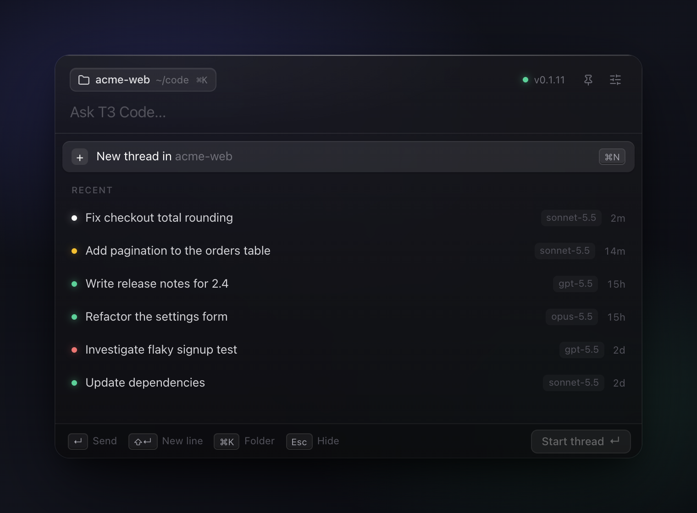
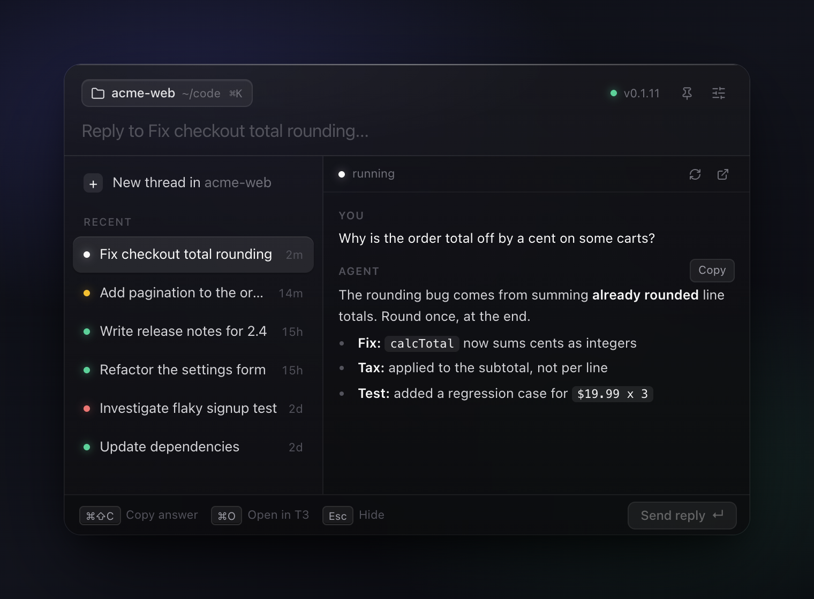
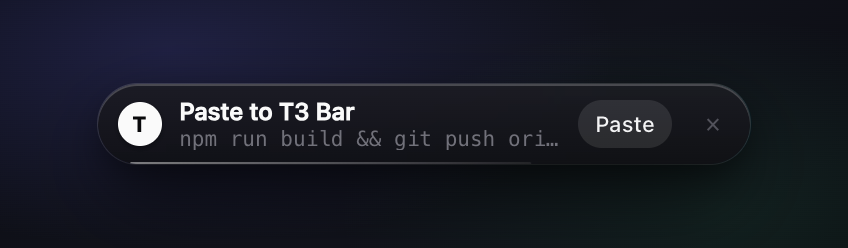
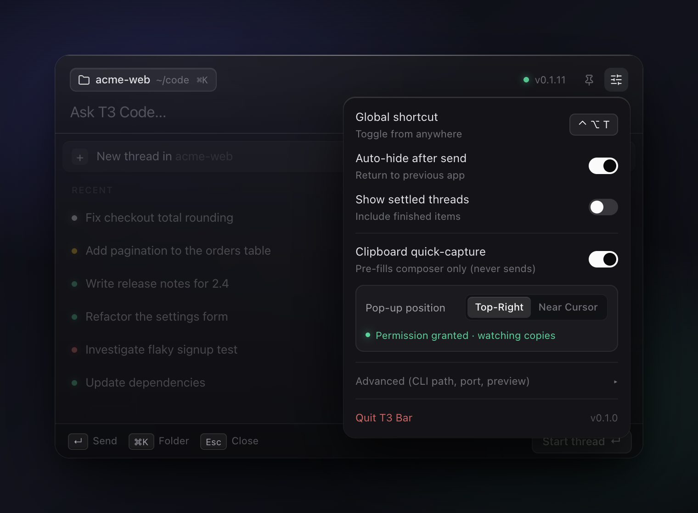

# T3 Bar

Minimal menu-bar launcher for [T3 Code](https://t3.codes) on your Mac. Press a shortcut, type a prompt, and send it to a new or existing thread without opening T3 Code.



## Features

- Prompt-first window. Type, press `Enter`, done.
- Pick a folder with `Cmd+K`, or use **No project** for T3 Code's scratch workspace.
- Recent threads for the current project, with status, model and age.
- Thread preview with rendered Markdown and one-click copy.
- Optional clipboard quick-capture (off by default, see below).
- Local only. It talks to the T3 Code server on your Mac and nothing else.



## Keyboard shortcuts

| Action | Key |
| --- | --- |
| Show or hide | Click the menu-bar icon, or `Ctrl+Option+T` |
| Send | `Enter` |
| New line | `Shift+Enter` |
| Choose folder | `Cmd+K` |
| New thread | `Cmd+N` |
| Open in T3 Code | `Cmd+O` |
| Copy the latest answer of the highlighted thread | `Cmd+Shift+C` |
| Move destination | `Up` / `Down` |
| Close | `Esc` (closes a popover first), or click outside unless pinned |

The global shortcut can be changed under Settings, Advanced.

## Clipboard quick-capture

When you copy text in another app, T3 Bar can show a small pill. Click it and the text lands in the composer, ready to edit.



- **Opt-in.** It is off by default. Turning it on shows a consent screen first.
- **In memory only.** Copied text is never saved, logged or sent. The pill only gets a short preview.
- **Never auto-sends.** The text is pre-filled and marked "Pasted from clipboard · not sent". Nothing goes out until you press `Enter`.
- **Skips password managers.** Items marked concealed, transient or auto-generated, and 1Password entries, are skipped before the text is read.
- **Stops at once.** Switching it off stops watching immediately.
- **Placement.** Choose Top-Right or Near Cursor. The pill never takes focus.

macOS may ask to allow "Paste from Other Apps". If access is blocked, Settings shows how to allow it in System Settings, Privacy & Security, then **Re-check**.



## Requirements

- macOS (Apple silicon or Intel)
- Node 22 and npm 10
- T3 Code running locally, with the `t3` CLI at `~/.t3/bin/t3`

## Setup

```sh
npm install
npm run dev          # Vite dev server + esbuild watch + Electron
npm start            # build, then run the app
npm run verify       # typecheck, tests, smoke test
npm run screenshots  # regenerate docs/*.png from demo data
```

The app has no Dock icon. Look for the "T" icon in the menu bar.

## Settings

Settings live in `settings.json` in the app's user data folder (`~/Library/Application Support/T3 Bar`). On first launch, T3 Bar copies settings from the old `t3-widget` folder once. The old folder is never changed, and old remote-machine entries and tokens are not carried over.

## Architecture and security

- Electron main process, React 19 renderer, Vite, Tailwind CSS v4.
- Sandboxed renderers with context isolation. The launcher and the pill each have their own preload script.
- Every IPC channel checks the sender page and window.
- A strict Content Security Policy blocks everything except the app's own files.
- The server URL must be loopback. The only network call is the local T3 Code health check.
- The `t3` CLI runs with `execFile`, never through a shell.
- Links open only if they match the allowlist.

Screenshots are generated from in-memory demo data in a temporary profile. No real projects or clipboard content are used.

## License

MIT. See [LICENSE](LICENSE).
